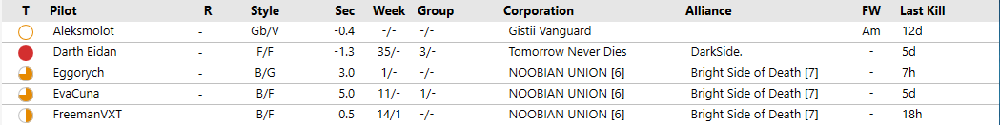
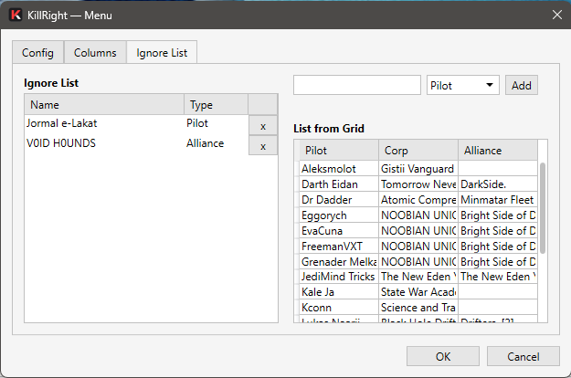
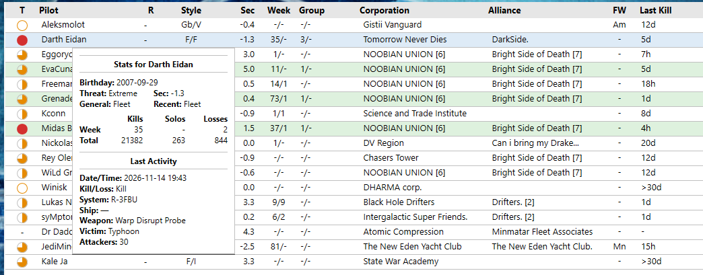
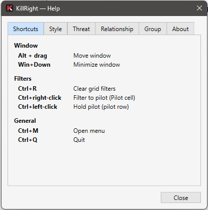
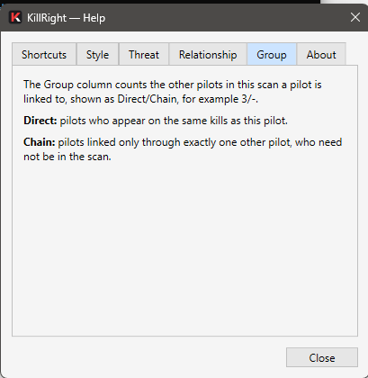

# KillRight User Guide

## Contents

- [What KillRight is](#what-killright-is)
- [Requirements](#requirements)
- [First run](#first-run)
- [Scanning](#scanning)
- [The grid](#the-grid)
- [Filters and the Ignore List](#filters-and-the-ignore-list)
- [The Info Sheet](#the-info-sheet)
- [The menu](#the-menu)
- [Shortcuts and the F1 help](#shortcuts-and-the-f1-help)
- [Good to know](#good-to-know)
- [Troubleshooting](#troubleshooting)
- [Report a problem](#report-a-problem)

## What KillRight is

KillRight is a Windows desktop tool that runs beside EVE Online. Copy a list of pilot names and KillRight looks each pilot up and shows a grid of what their recent kill history says about them, so you can judge a pilot before you act on them.

## Requirements

- Windows.
- The .NET 10 Desktop Runtime. Get it from the .NET download page at https://dotnet.microsoft.com/download/dotnet/10.0 (choose the Desktop Runtime for Windows).
- If the runtime is missing, the installer tells you and offers to open the download page. Install the runtime, then run the installer again.
- KillRight keeps your data, such as the pilot history it has gathered and its backups, in your own Windows user profile, in the local application data area. Each Windows user has a separate copy.

## First run

The first time KillRight starts it has no reference data, so it opens a window named "KillRight — Loading Reference Data". The window names each stage as it works (checking the manifest, downloading reference data, importing reference data) and shows the download progress. It has no cancel button, and no scan starts until it closes.

If loading fails, the window shows "Reference data load failed." with the reason and a Retry button. Select Retry to try again. When loading finishes the window closes and the main window is ready.

After that, KillRight refreshes the reference data in the background only when a new game build needs it, and it never blocks you from scanning.

## Scanning

Every scan starts from the clipboard. There is nothing to paste into KillRight.

1. In EVE Online, select the names you want in Local, in an intel channel or in a fleet window, and copy them (Ctrl+C).
2. KillRight notices the clipboard change and starts the scan on its own.
3. When the scan finishes, the grid fills with the pilots, in the order of your list.

What to expect:

- Each line of the copied text is checked on its own. Lines that are not shaped like a pilot name are dropped without notice.
- Names that appear more than once are scanned once.
- Names that EVE does not recognise are dropped without notice. If no name is recognised, the grid stays as it was.
- Only one scan runs at a time. Copying a new list cancels the running scan and starts a scan of the new list.
- The grid is updated once, when the scan finishes, not row by row.

## The grid

This section is written separately.

## Filters and the Ignore List

This section is written separately.

## The Info Sheet

This section is written separately.

## The menu

This section is written separately.

## Shortcuts and the F1 help

This section is written separately.

## Good to know

- Recent history starts thin on a new install and builds up as you scan pilots, so early scans show less than later ones.
- Any short copied text that looks like a character name starts a scan and can replace the grid. A single word or a system name is enough. Mixed text scans only the lines that pass, without notice.

## Troubleshooting

### "KillRight cannot start"

A dialog titled "KillRight cannot start" appears when startup fails, for example when the settings file is missing, cannot be read or is not valid. It gives the reason and ends with "See the log file for details." KillRight then closes.

### The log file

The log file records what KillRight did and why something failed. Look in it when the startup dialog appears, when reference data will not load or when a scan does not behave as you expect.

### Backups and restore

- When KillRight closes, its first step is to write a backup copy of the whole database to a local backup folder. A new copy replaces the previous one only when it is complete, and the last few copies are kept.
- Skip Backup on Close (in the Menu, Config tab) skips the backup once. It applies to the current session only, and the backup runs normally the next time KillRight starts. A skipped backup is acceptable because the previous copy stands.
- If the database is missing or damaged at startup, KillRight sets the damaged file aside and puts the latest readable backup in its place. If there is no readable backup, it starts with a new, empty database.
- History gathered between the last backup and a restore is lost for good when it is older than the range zKillboard still returns.

## Report a problem

Report problems, questions and ideas on the KillRight Issues page: https://github.com/menaceofmorons/Killright/issues
