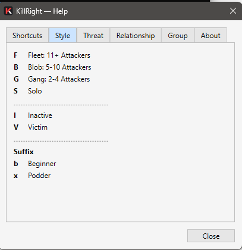
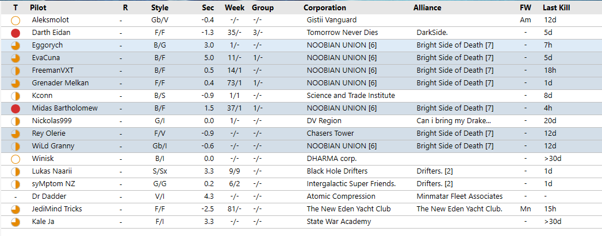
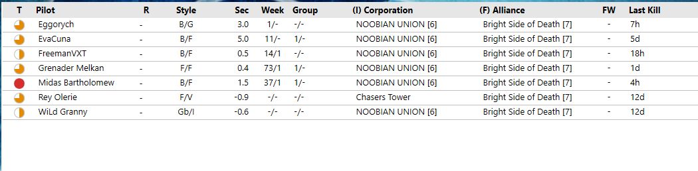
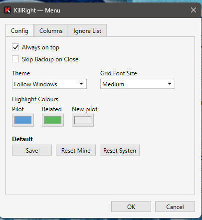

# KillRight User Guide

## Contents

- [What KillRight is](#what-killright-is)
- [Requirements](#requirements)
- [First run](#first-run)
- [Scanning](#scanning)
- [The grid](#the-grid)
- [Pilot Details](#pilot-details)
- [The Info Sheet](#the-info-sheet)
- [Filters](#filters)
- [The menu](#the-menu)
- [Shortcuts](#shortcuts)
- [Good to know](#good-to-know)
- [Troubleshooting](#troubleshooting)
- [Report a problem](#report-a-problem)

## What KillRight is

KillRight is a Windows desktop tool that runs beside EVE Online. Copy a list of pilot names and KillRight looks each pilot up and shows a grid of what their recent kill history says about them, so you can judge a pilot before you act on them.

## Requirements

- Windows.
- The .NET 10 Desktop Runtime. Get it from the .NET download page at https://dotnet.microsoft.com/download/dotnet/10.0 (choose the Desktop Runtime for Windows).
- If the runtime is missing, the installer tells you and offers to open the download page. Install the runtime, then run the installer again.
- KillRight keeps your data, such as the pilot history it has gathered and its backups, in your own Windows user profile, in the local application data area. Each Windows user has a separate copy.

## First run

The first time KillRight starts it has no reference data, so it opens a window named "KillRight — Loading Reference Data". The window names each stage as it works (checking the manifest, downloading reference data, importing reference data) and shows the download progress. It has no cancel button, and no scan starts until it closes.

If loading fails, the window shows "Reference data load failed." with the reason and a Retry button. Select Retry to try again. When loading finishes the window closes and the main window is ready.

After that, KillRight refreshes the reference data in the background only when a new game build needs it, and it never blocks you from scanning.

## Scanning

Every scan starts from the clipboard. There is nothing to paste into KillRight.

1. In EVE Online, select the names you want in Local, in an intel channel or in a fleet window, and copy them (Ctrl+C).
2. KillRight notices the clipboard change and starts the scan on its own.
3. When the scan finishes, the grid fills with the pilots, in the order of your list.

What to expect:

- Each line of the copied text is checked on its own. Lines that are not shaped like a pilot name are dropped without notice.
- Names that appear more than once are scanned once.
- Names that EVE does not recognise are dropped without notice. If no name is recognised, the grid stays as it was.
- Only one scan runs at a time. Copying a new list cancels the running scan and starts a scan of the new list.
- The grid is updated once, when the scan finishes, not row by row.

## The grid

Each row is one pilot. Select a column header to sort the grid by that column's value, not by the text shown. The header row is bold.

| Column | What it shows |
| --- | --- |
| T - Threat | How dangerous the pilot is likely to be, as a glyph. |
| Pilot | The pilot's name. An italic name means KillRight could not retrieve some of the pilot's data. |
| R - Relationship | How strongly each row is connected to the pilot you hover, hold or filter to, with a confidence square. |
| Style | The pilot's General and Recent Style, separated by a slash, for example `S/F`. |
| Sec | Security status, shown to one decimal place and cut off, not rounded. A value that cuts to zero shows `0.0`. `Unk` means it could not be retrieved. |
| Week | Kills this week, then solo kills this week, for example `4/2`. A dash stands for zero on either side, for example `5/-`. |
| Group | How many other scanned pilots this pilot is linked to, as Direct/Chain, for example `3/-` or `-/2`. |
| Corporation | The corporation name, followed by the same-group count. |
| Alliance | The alliance name, followed by the same-group count. Blank when the pilot has no alliance or the lookup failed. |
| FW | The pilot's faction warfare militia code, followed by `(n)` when two or more scanned pilots are in the same militia. A dash means not enlisted. |
| Last Kill | How long ago the pilot's last kill was: in hours first (at least `1h`), then in days, then a fixed over-limit text. A dash means no last kill, or the lookup failed. |

A dash means zero in every column, and it also shows where a value could not be retrieved. The failure itself is shown by the italic Pilot name.

### Threat

Threat shows how dangerous a pilot is likely to be. Press F1 and open the Threat tab for the glyphs and what each band means.

### Style

Style has two codes, General then Recent, for example `S/F`. A suffix can follow a code: `b` means Beginner, on the General code only, and `x` means Podder, for example `Sbx/Gx`. The F1 help, Style tab, gives the codes and the size definitions for Gang, Blob and Fleet.

### Relationship

The Relationship column is a dash until you hover a Pilot cell, hold a pilot (see Pilot hold) or filter to a pilot (see Filters). Then each row shows a number, the strength of its connection to that pilot, and a small grey square, the confidence that the shared kills are cooperation and not coincidence. The column shows a dash for rows with no relationship, for rows in the same corporation or alliance, and for the hovered or held row itself.

### Group

The Group column counts every pilot in the scan this pilot is linked to, shown as Direct/Chain. Direct counts pilots who appear on the same kills. Chain counts pilots linked only through exactly one other pilot, who need not be in the scan.

### Same-group counts

A number in square brackets after a Corporation or Alliance name, for example `[3]`, is how many scanned pilots share it.

### The hover highlight

Hover a Pilot cell for a moment and the rows related to that pilot are tinted. The hovered row takes the pilot colour. Rows in the same corporation or alliance take a lighter shade of it (darker on the light theme). Rows with a Direct or Chain relationship take the related colour. The tint clears when the mouse leaves the cell, and it is off while a Pilot Filter is on.

### Pilot hold

Ctrl+left-click a Pilot cell to hold that pilot. While a pilot is held, the Relationship column and the highlight show the held pilot, whatever you hover. Ctrl+left-click the held pilot again, press Ctrl+R, or start a new scan to release it.

### The new-pilot tint

After a scan, rows whose pilot was not in the previous scan are tinted in the new-pilot colour until the next scan. There is no tint on the first scan, or when the new scan shares no pilot with the previous one. The hover highlight replaces it while the highlight is active.

## Pilot Details

Right-click a Pilot cell to open the Info Sheet for that pilot. Double-click a Pilot cell to open the pilot's zKillboard page in your browser; nothing opens for a pilot that could not be resolved. With Always on top on, the browser may open beneath KillRight.

## The Info Sheet

The Info Sheet is a small window that opens at the cursor, below the row, and cannot be resized. Click anywhere else to close it.

The top half is titled "Stats for" followed by the pilot's name, and shows:

- Birthday.
- Threat, as the full band word.
- Sec.
- General and Recent Style, as full words, with "(podder)" where the pilot is marked as one.
- Faction, only when the pilot is in a militia.
- A table of Kills, Solos and Losses, for Week and Total. Pods are not counted. Zero shows as a dash.

The Corporation and Alliance are not on the sheet; they are in the grid.

The bottom half is titled Last Activity and describes the pilot's single most recent kill or loss, whenever it happened, with Date/Time, Kill/Loss, System and Ship. For a kill it also shows the pilot's own Weapon, the Victim and the Attackers. If the pilot has no such killmail, the body is empty.

Birthday and Last Activity load when the sheet opens, and show "Loading…" until they are ready. If a source fails, the first line of the sheet reads "Error loading" followed by the source, Birthday or Last Activity, and the fields show placeholders. Last Activity is tried again the next time you open the sheet.

## Filters

Filters change what the grid shows. They never change the scan, they are temporary, and they are never saved.

- **Ignore:** right-click a Corporation, Alliance, FW or Style cell and choose Ignore to hide every row with that value.
- **Filter to:** the same menu. Choose Filter to to show only rows with that value.
- **Pilot Filter:** Ctrl+right-click a Pilot cell to show only that pilot and the rows that share its corporation or alliance or have a Direct or Chain relationship to it. While it is on, the Relationship column shows relationships to that pilot, the hover highlight is off, and Ctrl+right-click does nothing.

For Style, the menu first asks for General or Recent. A Style filter matches the base code, so `S` matches `S`, `Sb`, `Sx` and `Sbx`. Blank alliances, `unk` corporations and blank FW cells cannot be filtered.

Filters stack: each new filter applies to the rows still visible. A column that carries an Ignore shows `(I)` before its title and one that carries a Filter to shows `(F)`. While a Pilot Filter is on, `(F)` shows before Pilot.

Filters clear when you press Ctrl+R, when a new scan starts, or when you hide a filtered column.

## The menu

Press Ctrl+M to open the menu. It is a window that stays in front of the main window until you close it, and the grid keeps refreshing behind it. It always opens on its first tab. Every change previews live. Select OK to keep the changes or Cancel to undo every previewed change.

### Config tab

- **Always on top** keeps KillRight above other windows.
- **Theme** is Light, Dark or Follow Windows.
- **Highlight Colours** are Pilot, Related and New pilot, each picked from a fixed palette. New pilot also offers Default. One choice works in both themes.
- **Grid Font Size** is Large, Medium, Small or Tiny. It sets the row and header height of the grid.
- **Skip Backup on Close** skips the backup once, for this session only, and shows a warning when ticked.
- **Default** has three buttons. Save keeps the previewed state as your default when you select OK. Reset Mine restores your saved default and is unavailable until you have saved one. Reset System restores the built-in defaults for theme, font size, always on top, colours, column set and order, and minimum window size. Your saved default covers window position and size, always on top, theme, font size, columns and colours, and never the Ignore List.

### Columns tab

Choose which columns show and in what order. Pilot cannot be hidden but can be moved. Dragging a column header in the grid changes the same order. Right-click a header and choose Hide to hide a column straight away, outside the preview. Hiding the sorted column sorts the grid by Pilot again. Column widths do not follow the font size, and text that does not fit is cut off.

### Ignore List tab

The Ignore List is a saved list of pilots, corporations and alliances that are left out of every scan. It is separate from the temporary Ignore filter in the grid. The list shows each entry's Name and Type (Pilot, Corp or Alliance) with an x to remove it. The List from Grid panel shows the Pilot, Corp and Alliance of the scanned pilots; select a cell to fill the entry box and Type. You can also type a name, choose the Type and select Add. KillRight checks the name with ESI and refuses a name it cannot find, or when ESI cannot be reached. Ignored entries are matched by ID, leave no row and no marker in the grid, and are not counted in the Group or same-group counts. Changes take effect on the next scan. The Ignore List is never reset by Reset Mine or Reset System.

## Shortcuts

| Shortcut | What it does |
| --- | --- |
| Alt + drag | Move window |
| Win+Down | Minimize window |
| Ctrl+R | Clear grid filters |
| Ctrl+right-click (Pilot cell) | Filter to pilot |
| Ctrl+left-click (pilot row) | Hold pilot |
| Ctrl+M | Open menu |
| Ctrl+Q | Quit |

## Good to know

- Recent history starts thin on a new install and builds up as you scan pilots, so early scans show less than later ones.
- Any short copied text that looks like a character name starts a scan and can replace the grid. A single word or a system name is enough. Mixed text scans only the lines that pass, without notice.

## Troubleshooting

### "KillRight cannot start"

A dialog titled "KillRight cannot start" appears when startup fails, for example when the settings file is missing, cannot be read or is not valid. It gives the reason and ends with "See the log file for details." KillRight then closes.

### The log file

The log file records what KillRight did and why something failed. Look in it when the startup dialog appears, when reference data will not load or when a scan does not behave as you expect. The file is `killright-engine.log` and it is in `%LOCALAPPDATA%\KillRight`.

### Backups and restore

- When KillRight closes, its first step is to write a backup copy of the whole database to a local backup folder. A new copy replaces the previous one only when it is complete, and the last few copies are kept.
- Skip Backup on Close (in the Menu, Config tab) skips the backup once. It applies to the current session only, and the backup runs normally the next time KillRight starts. A skipped backup is acceptable because the previous copy stands.
- If the database is missing or damaged at startup, KillRight sets the damaged file aside and puts the latest readable backup in its place. If there is no readable backup, it starts with a new, empty database.
- History gathered between the last backup and a restore is lost for good when it is older than the range zKillboard still returns.

## Report a problem

Report problems, questions and ideas on the KillRight Issues page: https://github.com/menaceofmorons/Killright/issues
