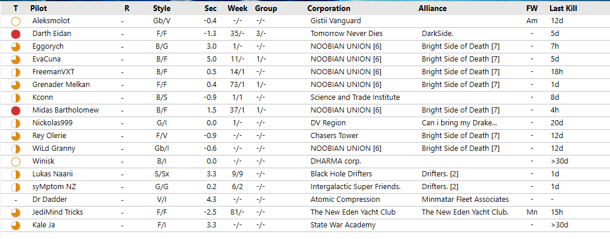
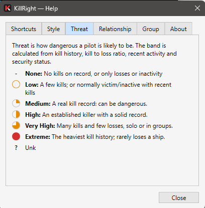
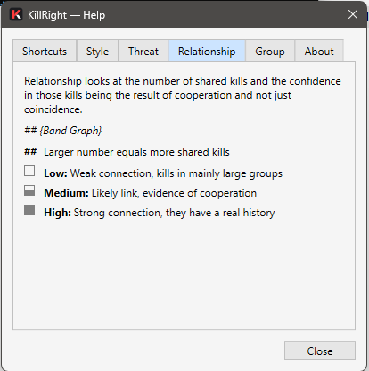
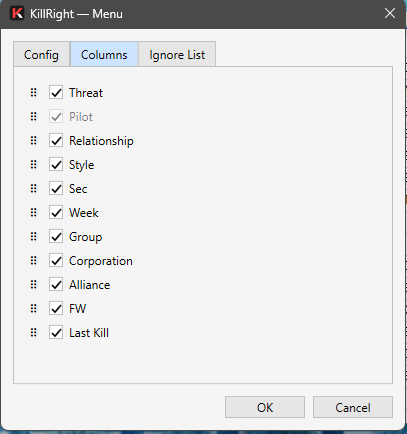

# KillRight User Guide

## Contents

- [What KillRight is](#what-killright-is)
- [Requirements](#requirements)
- [First run](#first-run)
- [Scanning](#scanning)
- [The grid](#the-grid)
- [Pilot Details](#pilot-details)
- [Filters](#filters)
- [Menu](#menu)
- [Shortcuts](#shortcuts)
- [Good to know](#good-to-know)
- [Troubleshooting](#troubleshooting)
- [Report a problem](#report-a-problem)

## What KillRight is

KillRight is a Windows desktop tool that runs beside EVE Online. Copy a list of pilot names and KillRight looks each pilot up and shows a grid of what their recent kill history says about them, so you can judge a pilot before you act on them.

## Requirements

- Windows.
- The .NET 10 Desktop Runtime. Get it from the .NET download page at https://dotnet.microsoft.com/download/dotnet/10.0 (choose the Desktop Runtime for Windows).
- If the runtime is missing, the installer tells you and offers to open the download page. Install the runtime, then run the installer again.
- KillRight keeps your data, such as the pilot history it has gathered and its backups, in your own Windows user profile, in the local application data area. Each Windows user has a separate copy.

## First run

The first time KillRight starts it has no reference data, so it opens a window named "KillRight — Loading Reference Data". The window names each stage as it works (checking the manifest, downloading reference data, importing reference data) and shows the download progress. It has no cancel button, and no scan starts until it closes.

If loading fails, the window shows "Reference data load failed." with the reason and a Retry button. Select Retry to try again. When loading finishes the window closes and the main window is ready.

After that, KillRight refreshes the reference data in the background only when a new game build needs it, and it never blocks you from scanning.

## Scanning

Every scan starts from the clipboard. There is nothing to paste into KillRight.

1. In EVE Online, select the names you want in Local, in an intel channel or in a fleet window, and copy them (*Ctrl+C*).
2. KillRight notices the clipboard change and starts the scan on its own.
3. When the scan finishes, the grid fills with the pilots, in the order of your list.

What to expect:

- Each line of the copied text is checked on its own. Lines that are not shaped like a pilot name are dropped without notice.
- Names that appear more than once are scanned once.
- Names that EVE does not recognise are dropped without notice. If no name is recognised, the grid stays as it was.
- Only one scan runs at a time. Copying a new list cancels the running scan and starts a scan of the new list.
- The grid is updated once, when the scan finishes, not row by row.

## The grid

Columns can be sorted (*Left-Click*), sized, moved (*Click-Drag*), hidden (*Right-Click*). To Unhide see ***Menu-Columns***.

| Column | What it shows |
| --- | --- |
| T - Threat | How dangerous the pilot is likely to be, as a glyph. |
| Pilot | The pilot's name. An italic name means KillRight could not retrieve some of the pilot's data. |
| R - Relationship | How strongly each row is connected to the pilot you hover, hold or filter to, with a confidence square. |
| Style | The pilot's General and Recent Style, separated by a slash, for example `S/F`. |
| Sec | Security status, shown to one decimal place and cut off, not rounded. A value that cuts to zero shows `0.0`. `Unk` means it could not be retrieved. |
| Week | Kills this week, then solo kills this week, for example `4/2`. A dash stands for zero on either side, for example `5/-`. |
| Group | How many other scanned pilots this pilot is linked to, as Direct/Chain, for example `3/-` or `-/2`. |
| Corporation | The corporation name, followed by the same-group count. |
| Alliance | The alliance name, followed by the same-group count. Blank when the pilot has no alliance or the lookup failed. |
| FW | The pilot's faction warfare militia code, followed by `(n)` when two or more scanned pilots are in the same militia. A dash means not enlisted. |
| Last Kill | How long ago the pilot's last kill was: in hours first (at least `1h`), then in days, then a fixed over-limit text. A dash means no last kill, or the lookup failed. |

A dash means zero in every column, and it also shows where a value could not be retrieved. The failure itself is shown by the italic Pilot name.

### Threat

### Style

Style has two codes, General then Recent, for example `S/F`, and may be followed by an additional suffix identifying Beginners and Podders.

### Relationship

The Relationship column activates when you hover a Pilot cell, hold a pilot (see Pilot hold) or filter to a pilot (see Filters). Then if a relationship (outside of Corp/Alliance) has been identified, each row shows a number and a Band Graph indicating the strength and confidence in that relationship.

### Group

The Group column counts every pilot (outside of Corp/Alliance) in the scan this pilot is linked to, shown as Direct/Chain. Direct counts pilots who appear on the same kills. Chain counts pilots linked through exactly one other pilot.

### Same-group counts

A number in square brackets after a Corporation or Alliance name, for example `[3]`, is how many scanned pilots share it.

### Visualising Relationships

Hover a Pilot cell for a moment and the rows related to that pilot are tinted.

- Hovered row takes the pilot colour.
- Rows in the same corporation or alliance take a lighter shade of it (darker on the light theme).
- Rows with a Direct or Chain relationship take the related colour.

The tint clears when the mouse leaves the cell, and it is off while a Pilot Filter is on.

### Pilot hold

*Ctrl+left-click* a Pilot cell to hold that pilot. While a pilot is held, the Relationship column and the highlight show the held pilot, whatever you hover. *Ctrl+left-click* the held pilot again, press *Ctrl+R*, or start a new scan to release it.

### New Pilots in Scan

After a scan, rows whose pilot was not in the previous scan are tinted in the new-pilot colour until the next scan.

## Pilot Details

Right clicking on a Pilot will bring up a detailed information sheet.

The Top half provides detailed statistics for the Pilot whilst the bottom describes their most recent zKill entry.

- A Kill will show what they killed, with what ship/weapon, and how many attackers involved.
- A Loss will show what ship they lost.

Double-click a Pilot cell to open the pilot's zKillboard page in your browser.

## Filters

You can activate grid filters to limit what you see:

- **Ignore:** right-click a Corporation, Alliance, FW or Style cell and choose Ignore to hide every row with that value.
- **Filter to:** the same menu. Choose Filter to to show only rows with that value.
- **Pilot Filter:** *Ctrl+right-click* a Pilot cell to show only that pilot and the rows that share its corporation or alliance or have a Direct or Chain relationship to it. While it is on, the Relationship column shows relationships to that pilot, the hover highlight is off, and *Ctrl+right-click* does nothing.

Filters stack: each new filter applies to the rows still visible. A column that carries an Ignore shows `(I)` before its title and one that carries a Filter to shows `(F)`. While a Pilot Filter is on, `(F)` shows before Pilot.

Filters clear when you press *Ctrl+R*, when a new scan starts, or when you hide a filtered column.

## Menu

*Ctrl+M* open the menu. Changes preview live. Selecting OK will keep the changes and Cancel will undo.

### Config

- **Always on top** Keep KillRight above other windows.
- **Theme** Select the colour scheme of KillRight
- **Highlight Colours** How Pilot, Related and New pilot are highlighted on the grid.
- **Grid Font Size** Set to Large, Medium, Small or Tiny.
- **Skip Backup on Close** Skip the backup once, for this session only.
- **Default**
  - ***Save:*** Creates a snapshot of current settings as your default
  - ***Reset Mine:*** Resets to the last saved snapshot
  - ***Reset System:*** Resets to the system defaults

### Columns

Choose which columns show and in what order. Pilot cannot be hidden but can be moved.

### Ignore List

The Ignore List identifies pilots, corporations and alliances that are left out of every scan. It is distinct from the temporary Ignore filter in the grid.

- To Add to the list you can either select from the provided Grid list, or type your own entry, selecting the type (Pilot, Corp, Alliance).
- To Remove an entry from the list, simply click the `x` at the end of the row.

## Shortcuts

| Shortcut | What it does |
| --- | --- |
| Alt + drag | Move window |
| Win+Down | Minimize window |
| Ctrl+R | Clear grid filters |
| Ctrl+right-click (Pilot cell) | Filter to pilot |
| Ctrl+left-click (pilot row) | Hold pilot |
| Ctrl+M | Open menu |
| Ctrl+Q | Quit |

## Good to know

- Recent history starts thin on a new install and builds up as you scan pilots, so early scans show less than later ones.
- Any short copied text that looks like a character name starts a scan and can replace the grid. A single word or a system name is enough. Mixed text scans only the lines that pass, without notice.

## Troubleshooting

### "KillRight cannot start"

A dialog titled "KillRight cannot start" appears when startup fails, for example when the settings file is missing, cannot be read or is not valid. It gives the reason and ends with "See the log file for details." KillRight then closes.

### The log file

The log file records what KillRight did and why something failed. Look in it when the startup dialog appears, when reference data will not load or when a scan does not behave as you expect. The file is `killright-engine.log` and it is in `%LOCALAPPDATA%\KillRight`.

### Backups and restore

- When KillRight closes, its first step is to write a backup copy of the whole database to a local backup folder. A new copy replaces the previous one only when it is complete, and the last few copies are kept.
- Skip Backup on Close (in the Menu, Config tab) skips the backup once. It applies to the current session only, and the backup runs normally the next time KillRight starts. A skipped backup is acceptable because the previous copy stands.
- If the database is missing or damaged at startup, KillRight sets the damaged file aside and puts the latest readable backup in its place. If there is no readable backup, it starts with a new, empty database.
- History gathered between the last backup and a restore is lost for good when it is older than the range zKillboard still returns.

## Report a problem

Report problems, questions and ideas on the KillRight Issues page: https://github.com/menaceofmorons/Killright/issues
