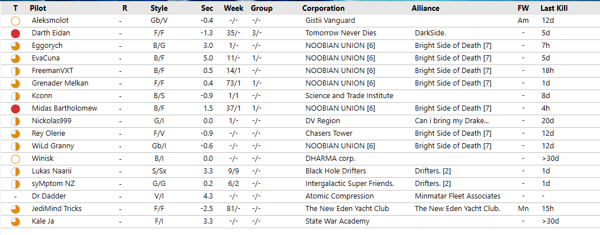
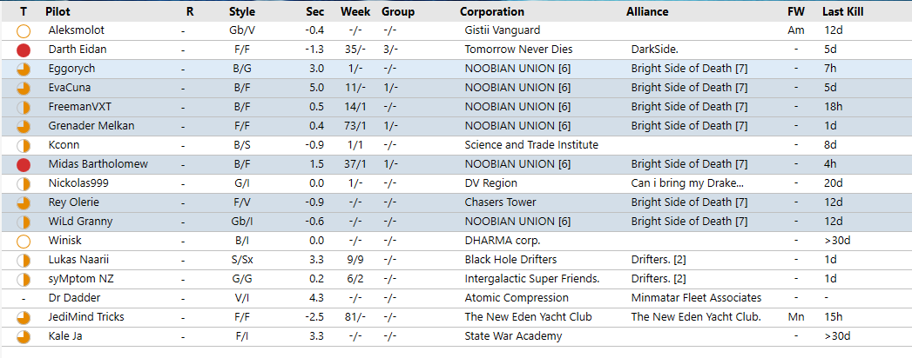
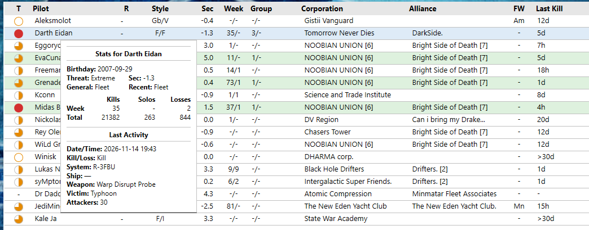

# KillRight

A Windows desktop tool that runs beside EVE Online and shows what each pilot's recent kill history says about them, from a list of names you copy.

## Download

Get the latest installer from the [releases page](https://github.com/menaceofmorons/Killright/releases).

- KillRight is in Beta.
- It needs Windows.
- It needs the .NET 10 Desktop Runtime. If it is missing, the installer tells you and offers to open the [download page](https://dotnet.microsoft.com/download/dotnet/10.0); install the Desktop Runtime for Windows, then run the installer again.

## What it does

Copy a list of pilot names in EVE Online and KillRight looks each pilot up and fills a grid with their threat, style, recent activity and links to the other pilots in your list, so you can judge a pilot before you act on them.

Hover a pilot to highlight how the other rows relate to them.

Open a pilot's Info Sheet for the detail behind the row.

## Quick start

1. Install the .NET 10 Desktop Runtime if you do not have it, then run the KillRight installer.
2. Start KillRight. The first time, it loads reference data and shows a loading window; wait for it to close.
3. In EVE Online, select the names in Local, in an intel channel or in a fleet window, and copy them (Ctrl+C). KillRight notices the clipboard change and starts the scan on its own.
4. When the scan finishes, read the grid. Sort a column with a left-click, and hover a pilot to see how the other rows relate to them.

The full guide covers every column, the Info Sheet, filters, the menu and the shortcuts: [User Guide](Docs/User-Guide.md).

## Get help

- [Report a bug](https://github.com/menaceofmorons/Killright/issues/new/choose)
- [Request a feature](https://github.com/menaceofmorons/Killright/issues/new/choose)
- [Ask a question](https://github.com/menaceofmorons/Killright/discussions)
- [Share an idea](https://github.com/menaceofmorons/Killright/discussions)

And on Discord at: https://discord.gg/TAYpyuDzQd
